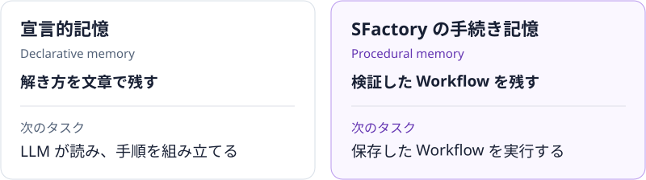
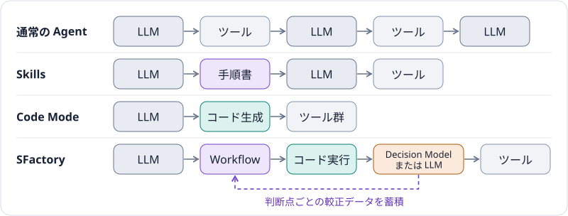
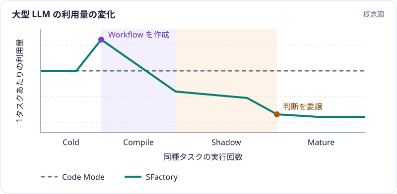

# SFactory

SFactory は、Pi Coding Agent が解いたタスクの手順を JavaScript の Workflow として保存する拡張です。たとえば問い合わせの担当チームと優先度を付ける手順を保存すると、Pi は次の問い合わせを保存済みの `wf_<name>` ツールで処理できます。



[これまでの実験結果](#これまでの実験結果) · [実験を再現する](#実験を再現する) · [チケットのデモを試す](#チケットのデモを試す) · [Workflow の書き方](skills/workflow-compile/SKILL.md)

## 解いたタスクを Workflow にする

1. **記録する。** Pi が通常のツールでタスクを解きます。SFactory はツールの呼び出しと結果を記録します。
2. **検証して保存する。** Pi が `workflow_trace` で記録を読み、入力と手順を分けてコードを書きます。`workflow_save` は記録の応答を使ってコードを実行し、必要な更新操作を再現できた場合に保存します。リプレイ中は実際のツールを呼び出しません。`decide()` の答えが記録と食い違っても、少数であれば保存し、食い違った判断を結果に列挙します。
3. **次のタスクで実行する。** Pi が `wf_<name>` を選び、Workflow がツールの呼び出しや条件分岐を処理します。判断が必要な箇所は `decide()` でモデルに問い合わせます。扱えない入力では、実行済みの更新を伝えて残りを Pi に引き継ぎます。



Skills は手順書を次のタスクに持ち越します。Code Mode は、そのタスクで使う複数のツール操作をコードにまとめられます。SFactory は、記録で検証したコードを次のタスクでも使えるツールとして保存します。成功した Workflow の実行例も、次にコードを更新するときのリプレイに使います。

## 判断点ごとにモデルを切り替える

チケットの取得や更新はコードで処理し、本文から担当チームを選ぶような判断を `decide()` に渡します。最初は LLM の回答を使い、Decision Model の回答と照合します。回答の一致率などが基準を満たした判断点では、信頼度が十分な回答を Decision Model に任せます。信頼度が低い場合や定期監査では LLM が判断します。



同種のタスクを繰り返した場合の概念図です。Compile で Workflow を作るコストがかかり、再利用できる手順が増えると、タスクごとに手順を組み立てる負担が減ります。Shadow で判断点ごとの較正データを蓄積し、条件を満たした判断点は Mature で委譲できます。

## これまでの実験結果

2026年11月26日時点の、小規模な開発用実験の結果です。上の概念図が示す流れのうち、実モデルで確認できた部分と、まだ分からない部分を分けて書きます。

**条件**

- 課題はサポートチケットのトリアージです。担当チーム、優先度、ステータスを付け、対象外のチケットはルーティングガイドに従って扱います。ガイドは依頼文ではなくツールから読みます。
- 大型モデルは `openai/gpt-6.1-terra`(thinking は low)、Decision Model は `openai/gpt-6-luna` です。
- 1試行は新しいセッションと新しいチケット群です。Workflow を使う構成だけ、保存した Workflow を試行間で引き継ぎます。
- 採点はチケットの最終状態だけを見る決定的な Verifier で行い、モデルの発話は使いません。
- 使ったのは開発用データだけです。学習用が8件×3回分、較正用が9件×4回分です。未見評価用と例外・適応評価用のデータは、まだ走らせていません。
- Workflow や回答は事前に用意していません。保存するかどうかはモデルが決めています。

集計表は [experiments/results/2026-11-26-dev/](experiments/results/2026-11-26-dev/) にあります。同じ実験は[実験を再現する](#実験を再現する)の手順で実行できます。

**確認できたこと**

| 確認したこと | 結果 |
|---|---|
| モデルが自分から Workflow を保存するか | 6回の系列すべてで、2〜3試行目に保存が成立しました。拒否は0回です |
| 保存した Workflow が次の試行で使われるか | 保存後の全試行で使われました(較正用データで12試行中12試行) |
| 判断が Decision Model に移るか | 判断点ごとに20件の比較がたまった時点で、2つの判断点がどちらも移りました。その後、単独での回答が43回、監査が3回、信頼度不足による LLM への差し戻しが2回、不一致が1回です |

較正用データの4回分を、構成ごとに比べた結果です。

| 構成 | 試行数 | 正しく処理したチケット | 大型モデルの呼び出し | 時間 | 費用 |
|---|---|---|---|---|---|
| Pi のみ | 8 | 67/72 | Agent 5.1回 | 17.0秒 | $0.010 |
| Workflow のみ(判断は LLM) | 8 | 68/72 | Agent 2.0回 + 判断17.5回 | 31.0秒 | $0.018 |
| Workflow と Decision Model | 4 | 36/36 | 下の表 | 下の表 | 下の表 |

時間と費用は1試行あたりの平均で、費用は Pi のカタログ価格からの計算値です。

Decision Model を使う構成は、同じ系列の中で次のように変わりました。4試行とも9件すべて正しく処理しています。

| 較正用データ | 時間 | LLM による判断 | Decision Model が単独で答えた判断 | 費用 |
|---|---|---|---|---|
| 1回目 | 29.8秒 | 18回 | 0回 | $0.020 |
| 2回目 | 20.0秒 | 7回 | 11回 | $0.012 |
| 3回目 | 13.4秒 | 3回 | 16回 | $0.009 |
| 4回目 | 12.4秒 | 2回 | 16回 | $0.008 |

Workflow を保存する試行は、65〜92秒、$0.04〜0.05 かかりました。保存しない初回の試行は約$0.011です。

**保存条件を変えた経緯**

最初の試行では、モデルが書いた Workflow の保存が拒否されました。モデルが手作業で `normal` とした優先度を、リプレイ中の `decide()` が `low` と答え、記録と1件ずれたためです。正解は `low` でした。

同じモデルでも、十数件の判断がすべて前回と一致するとは限りません。そこで保存条件を次のように変えました。記録にない更新操作が出たら、記録と一致する判断の答えを探して続行し、食い違った判断を保存結果に列挙します。食い違いが判断全体の25%を超える場合は保存を拒否します。上の結果はこの変更後のもので、6回の保存のうち2回で、合わせて3件の食い違いが報告されました。

**考えられること**

どれも仮説で、まだ確かめていません。

- **Workflow だけでは得にならない課題がある。** 判断を LLM に任せる構成は、Pi のみより遅く、費用も高くなりました。Pi のみでは8〜9件を1回の応答でまとめて判断でき、入力の多くがキャッシュから読まれます。Workflow はチケットごとに LLM を呼び、その入力はキャッシュされません。件数が多い場合や手順が長い場合に逆転するかは未確認です。複数の判断を1回の呼び出しにまとめれば差が縮む可能性もあります。
- **費用の回収には15回以上の再利用が要る。** Decision Model に移った後(3回目と4回目の平均)の差は、Pi のみと比べて1試行あたり約4秒、約$0.002です。保存に余分にかかる費用は$0.03〜0.04なので、費用だけで見ると回収に15〜20回かかる計算です。
- **一致率が高かったのは、較正用データが易しかったからかもしれない。** 比較した判断はほぼすべて一致し、その結果、Decision Model に任せる信頼度の下限は観測された最低値(0.49と0.14)まで下がりました。事実上すべての回答を採用する状態です。唯一の不一致は信頼度0.14の回答でした。言葉づかいが別のチームを指すチケットや対象外のチケットが多い未見データで、誤った回答をそのまま採用する恐れがあります。
- **正答数の差は偶然の範囲かもしれない。** Decision Model を使う構成は36件すべて正解でしたが、4試行・1系列だけです。チケットごとに絞った問いのほうが判断が安定する可能性はありますが、この件数では区別できません。
- **保存条件の緩和で、質の低い判断基準が通る可能性がある。** 25%という上限に根拠はありません。
- **正解ラベルに疑わしいものがある。** 学習用の1件は、ガイドの文面に従うとモデルの答えのほうが妥当に見えます。全構成で同じ回が失敗している一因です。
- **1つのモデルでの結果である。** 別のモデルで、保存を試みるか、通るコードを書けるかは分かりません。

**まだ確かめていないこと**

- 未見のチケットでの正答率と、学習を止めた状態での評価
- 依頼の言い換え、対象キューの変更、要件の追加、ガイドの改訂への対応
- 別の作業に Workflow を誤って使わないか
- 一覧が複数ページに分かれる場合や、更新が拒否される場合の挙動
- 系列を増やしたときのばらつき

## 実験を再現する

上の結果を出した実験と、まだ実行していない本試行は、同じコマンドで走らせられます。必要なのは Node.js 22.19.0 以上と OpenAI の API キー1つです。大型モデルも Decision Model も OpenAI API で動きます。

```sh
npm ci
export OPENAI_API_KEY=sk-...
npm run exp -- doctor
```

`doctor` は、大型モデルと Decision Model をそれぞれ1回ずつ実際に呼び出して確認します。`openai` プロバイダに OAuth でログインしていると Decision Model が使えないので、その場合は `npx pi auth logout openai` を実行します。

**まず小さく確かめる**

```sh
npm run exp -- run --arms A,E --limit 1 --out runs/smoke
```

2つの構成で4試行ずつ、計8試行だけ走らせます。3分ほど、$0.1 程度です。

**開発用データで段階を追う**

上の結果は次の3つで出したものです。合計30試行、$0.8 程度でした。

```sh
for r in 0 1 2; do npm run exp -- run --arms D --phases train --repeat $r --out runs/s1; done
for r in 0 1; do npm run exp -- run --arms A,D --phases train,calib --repeat $r --out runs/s2; done
npm run exp -- run --arms E --phases train,calib --out runs/s3
```

**本試行**

5つの構成を、学習用、較正用、未見評価用、例外・適応評価用の全20回分で比べます。未見評価用と例外・適応評価用では学習を止め、その時点の Workflow と較正状態を固定して評価します。

```sh
for r in 0 1 2; do npm run exp -- run --repeat $r --out runs/final; done
```

3系列で300試行です。開発用の実行の単価から見積もると、$6〜8、2〜3時間かかります。中断しても、同じコマンドをもう一度実行すれば続きから再開します。

| 構成 | 内容 |
|---|---|
| A | Pi のみ |
| B | Pi と Code Mode |
| C | Pi と Code Mode。スクリプトから Decision Model を呼べます |
| D | Code Mode と Workflow。判断には LLM を使います |
| E | Code Mode と Workflow。判断を Decision Model に移していきます |

**結果を読む**

```sh
cat runs/final/report.md                                     # 集計表
npm run exp -- inspect --out runs/final --arm E --trial 2    # 1試行の発話とツール呼び出し
npm run exp -- replay --out runs/final --arm E               # 直近の保存を保存条件にかけ直す
```

`report.md` には、構成とフェーズごとの成功率、正しく処理した件数、時間、モデルの呼び出し回数とトークン数、費用、Workflow の保存・再利用・誤適用、Decision Model の採用・監査・不一致、不要または禁止された更新、判断点ごとの較正状態が出ます。試行ごとの記録は `runs/final/rep<n>/<構成>/trials/` に残ります。

**本試行の前に知っておくこと**

- 未見評価用と例外・適応評価用のデータは、一度見て調整すると未見ではなくなります。本試行はコードを固定してから1回だけ走らせてください。
- Decision Model に任せる信頼度の下限は設けていません。「考えられること」に書いたとおり、未見データで誤った回答を採用する恐れがあり、それ自体が本試行で測る対象です。
- 学習用の1件は正解ラベルが疑わしいままです。全構成に同じように効きます。
- 全構成で、モデルが使えるのは課題用のツールと `read` だけです。正解データを隔離するために `bash` や `write` を外しています。

データセット、Verifier、計測項目、もう1つの課題(CI の失敗調査)については [experiments/README.md](experiments/README.md) を参照してください。

## チケットのデモを試す

Node.js 22.19.0 以上で、リポジトリのルートから実行します。

```sh
npm ci
npm run demo:reset -- 1
npm run pi
```

Pi で `/login` を実行し、利用するモデルのプロバイダを設定します。Decision Model の利用には別途、対応する分類モデルへのアクセスが必要です。LLM のみで試す場合は `npm run pi:wf` で起動します。

1. 「未処理のサポートチケットをトリアージして。担当チームと優先度を付けて」と依頼します。
2. `/tickets reset 2` でチケットを入れ替え、同じ依頼をします。
3. 「いまのトリアージを再利用できるようにして」と依頼します。リプレイに通ると、`workflow_save` の結果に登録された `wf_<name>` が表示されます。
4. `/tickets reset 4` を実行し、保存済みの Workflow でトリアージを依頼します。`/wf` で Workflow の状態と実行回数を確認できます。
5. `/tickets reset 3` で通常の分類に当てはまらないチケットが混ざるバッチを用意します。Workflow が扱えないチケットで停止した場合は、Pi が残りを引き継ぎます。

API キーを使わずに一連の動作を確認するには、`npm test` を実行します。疑似モデルで初回実行、保存、再利用、エスカレーションを確認できます。

## 設定と保存先

| コマンド | 起動する構成 |
|---|---|
| `npm run pi:base` | Pi とデモ用のチケットツール |
| `npm run pi:codemode` | Pi と Code Mode |
| `npm run pi:wf` | Code Mode と Workflow Memory。判断には LLM を使います。 |
| `npm run pi` | Code Mode と Workflow Memory。利用可能な Decision Model があれば較正します。 |

<details>
<summary>環境変数と Workflow の状態</summary>

| 環境変数 | 設定 |
|---|---|
| `SFACTORY_DECIDE` | `auto` が既定です。`llm` で LLM のみを使用します。 |
| `SFACTORY_CLASSIFIER` | Decision Model を `provider/id` で指定します。既定は利用可能な最初の分類モデルです。 |
| `SFACTORY_ASK_MODEL` | `decide()` と `ask()` が使うチャットモデルです。既定はセッションのモデルです。 |
| `SFACTORY_MIN_SAMPLES` | 判断の委譲を検討するために必要な比較数です。既定は 20 です。 |
| `SFACTORY_TERMINATE` | `1` で `trusted` な Workflow の成功後に要約ターンを省きます。 |

新規保存時は `candidate`、初回成功で `probation`、成功が3回に達すると `trusted` になります。実行に失敗すると成功のカウントをリセットし、状態を1段戻します。エスカレーションの回数は別に記録します。

Workflow は QuickJS で実行します。保存時とコードのハッシュやツールのスキーマが異なる場合は実行を拒否します。既定の上限はツール呼び出し200回、`decide()` と `ask()` の合計200回、実行時間5分です。

```text
.pi/traces/                     Pi の実行記録。直近50件
.pi/workflows/<name>/
  workflow.js                   保存済みのコード
  meta.json                     実行状態、統計、判断点ごとの較正データ
  fixtures/                     リプレイに使う実行記録
  versions/                     過去のコード
  runs/                         失敗時とエスカレーション時の記録
```

</details>
